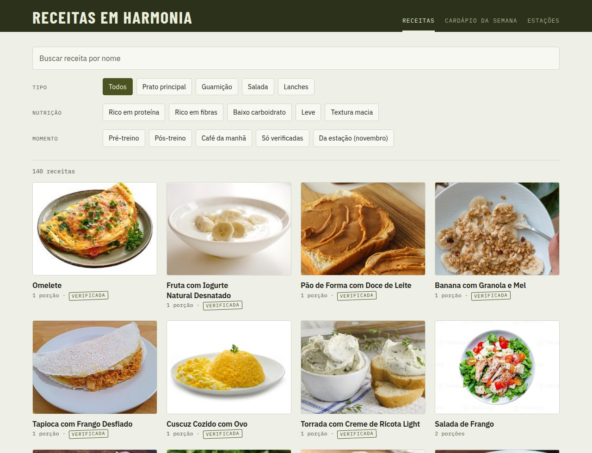
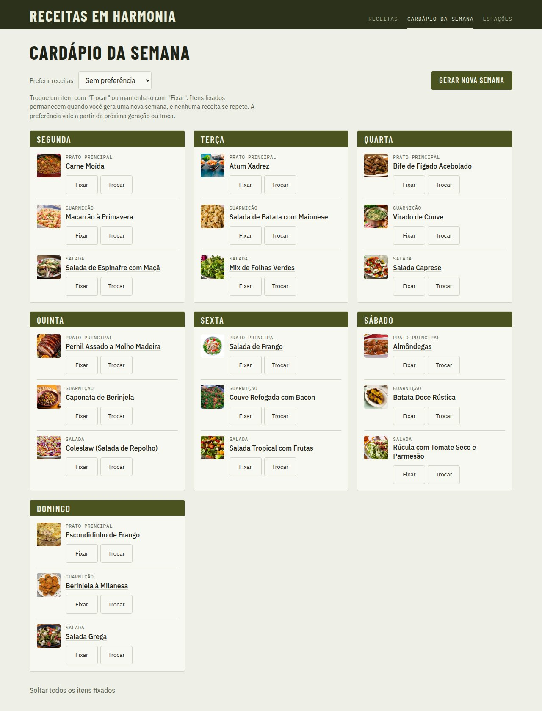
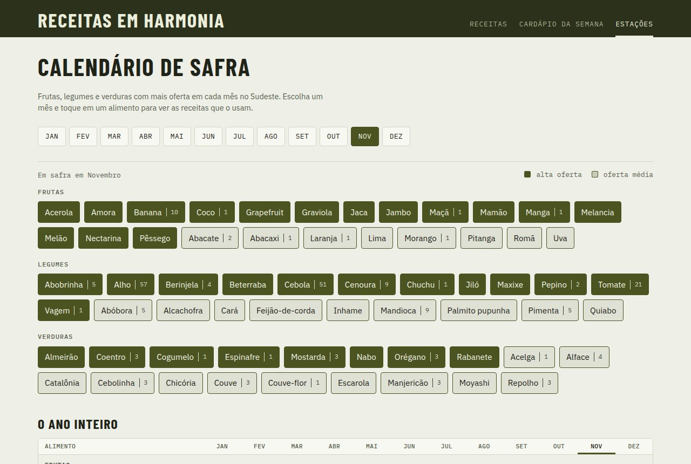
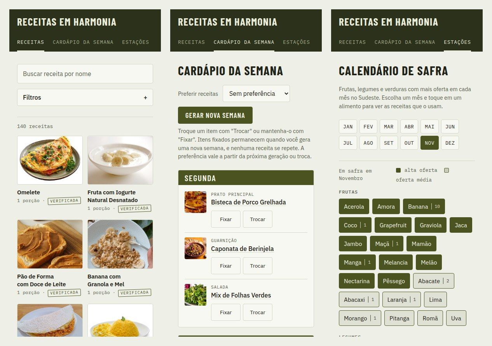

# Receitas em Harmonia

Site estático de receitas e planejamento de cardápio semanal, feito para uso pessoal. Reúne 140 receitas com busca e filtros, monta um cardápio de 7 dias sem repetir pratos e mostra o que está em safra em cada mês no Sudeste.

Não precisa de backend nem de banco de dados: tudo roda no navegador a partir de dois arquivos JSON.

**Acesse:** [rafaelladuarte.github.io/weekly-menu-generator](https://rafaelladuarte.github.io/weekly-menu-generator/)



## Funcionalidades

### Receitas

- Busca por nome, ignorando acentos.
- Filtros combináveis:
  - **Tipo:** prato principal, guarnição, salada e lanches.
  - **Nutrição:** rico em proteína, rico em fibras, baixo carboidrato, leve e textura macia.
  - **Momento:** pré-treino, pós-treino e café da manhã.
  - **Só verificadas:** receitas que já foram testadas.
  - **Da estação:** receitas com ingredientes em alta oferta no mês atual.
- Cada receita abre em uma janela com ingredientes, modo de preparo, tags, proteína por porção (quando informada) e os ingredientes que estão em safra.

### Cardápio da semana

- Sorteia prato principal, guarnição e salada para os 7 dias, sem repetir receitas.
- **Trocar** substitui um item e **Fixar** o mantém quando você gera uma nova semana.
- **Preferir receitas:** dá prioridade a uma tag (proteína, fibras, pós-treino, textura macia etc.) ou aos ingredientes da estação.
- O cardápio fica salvo no navegador (`localStorage`) e continua o mesmo ao recarregar a página.



### Calendário de safra

- Escolha um mês e veja as frutas, legumes e verduras com alta oferta e oferta média.
- Cada alimento mostra quantas receitas o usam, e tocar nele lista essas receitas.
- A matriz do ano inteiro mostra o mês atual destacado.



### Celular

O layout se adapta a telas pequenas. No celular, os filtros ficam recolhidos e os botões têm tamanho adequado para toque.



## Como rodar localmente

O site carrega os dados com `fetch`, então não funciona abrindo o `index.html` direto do disco. Use um servidor local:

```bash
git clone https://github.com/rafaelladuarte/weekly-menu-generator.git
cd weekly-menu-generator
python3 -m http.server 8000
```

Depois acesse `http://localhost:8000`.

## Estrutura do projeto

| Arquivo | Função |
|---|---|
| `index.html` | Lista de receitas com busca e filtros |
| `gerador.html` | Cardápio da semana |
| `estacoes.html` | Calendário de safra |
| `app.js` | Código compartilhado: carregamento dos dados, modal da receita, escape de HTML e lógica de safra |
| `styles.css` | Estilos de todas as páginas |
| `receitas.json` | Receitas |
| `sazonalidade.json` | Safra mensal de frutas, legumes e verduras |
| `imagens/` | Fotos das receitas e ícones do site |

## Como adicionar uma receita

Acrescente um objeto ao `receitas.json`:

```json
{
    "nome": "Omelete",
    "verificado": true,
    "porção": 1,
    "proteina": "22–25 g",
    "ingredientes": {
        "Ovos": "2 unidades",
        "Queijo": "50g"
    },
    "receita": [
        "Bata os ovos em uma tigela.",
        "Cozinhe em uma frigideira até firmar."
    ],
    "categorias": ["Lanches"],
    "tags": ["Rico em proteína", "Café da manhã"],
    "image": "omelete.webp"
}
```

- `categorias` aceita `Prato Principal`, `Guarnição`, `Salada` e `Lanches`. O gerador usa as três primeiras.
- `tags` aceita `Rico em proteína`, `Rico em fibras`, `Baixo carboidrato`, `Leve`, `Textura macia`, `Pré-treino`, `Pós-treino` e `Café da manhã`.
- `proteina` é opcional e aparece no cartão e na janela da receita.
- `image` é o nome do arquivo dentro de `imagens/`. Para uma receita sem foto, use `sem-imagem.png` e o site mostra um bloco "Sem foto".
- Escreva os ingredientes com o nome do alimento (por exemplo, "Tomate" ou "Batata Doce"). É assim que o site descobre o que está em safra.

## Sobre os dados de safra

O `sazonalidade.json` classifica cada mês de cada alimento como alta oferta, oferta média ou baixa oferta. As fontes são:

- **[CEAGESP: sazonalidade dos produtos comercializados no ETSP (2019 a 2023)](https://ceagesp.gov.br/wp-content/uploads/2024/02/Mapa-Sazonalidade-2019-a-2023_FEV24-.pdf):** base mensal. Cada mês é comparado com a média de 60 meses de entradas no entreposto. As variedades nacionais foram agrupadas por alimento.
- **[IDEC: alimentos de cada estação](https://idec.org.br/dicas-e-direitos/descubra-quais-sao-os-alimentos-de-cada-estacao)** e **[Organis: as frutas de cada estação](https://organis.org.br/as-frutas-de-cada-estacao/):** conferência por estação.

Limites a considerar:

- Os dados da CEAGESP medem o que chega ao entreposto de São Paulo, o que indica a safra no Sudeste, mas não é a colheita em Minas Gerais.
- Frutas que passam por câmara fria, como a maçã, podem aparecer fora da colheita.
- Alho, cebola e temperos verdes aparecem no calendário, mas não contam para o filtro "da estação", porque estão em quase todas as receitas.
- A ligação entre ingredientes e alimentos é feita pelo nome, então pode errar em casos como "Suco de Limão".

## Tecnologias

- HTML, CSS e JavaScript puros, sem etapa de build.
- [Bootstrap 5](https://getbootstrap.com/) (apenas para a janela da receita e utilitários).
- Fontes Barlow Condensed, IBM Plex Sans e IBM Plex Mono, via Google Fonts.
- Hospedagem no GitHub Pages.

## Contribuições

Contribuições são bem-vindas. Se você tem sugestões de melhorias ou encontrou algum problema, abra uma issue ou crie um pull request.

## Licença

Este projeto está licenciado sob a [MIT License](LICENSE).

## Contato

- **Nome:** Rafaella Duarte
- **Email:** [rafaella.d.d.carvalho@gmail.com](mailto:rafaella.d.d.carvalho@gmail.com)
- **LinkedIn:** [Rafaella Duarte](https://www.linkedin.com/in/rafaella-duarte-carvalho/)
